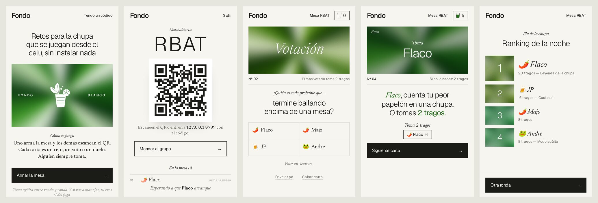

# FONDO

Shot dares for a night out. One phone opens a table, the rest scan the QR and play from their own phones, no install.

Live at https://fondo-blanco.pages.dev



## How it runs

- `src/worker.ts`: Cloudflare Worker that serves `public/` and the API. Each table is one Durable Object that keeps the game state and talks to the phones over WebSockets. Tables delete themselves after 48 h.
- `src/game.ts`, `src/cards.ts`: game rules and the card deck.
- `public/`: plain JS client, no build step.
- `edge/`: Pages project that only forwards every request to the `fondo` worker, so the app gets a `pages.dev` URL. The worker itself has no public URL.

## Commands

```sh
npm install
npm run dev                                          # local at http://localhost:8787
npm test                                             # E2E with Playwright against BASE_URL (default localhost:8787)
BASE_URL=https://fondo-blanco.pages.dev npm test     # E2E against production
npm run deploy                                       # worker, then the Pages front door
```
